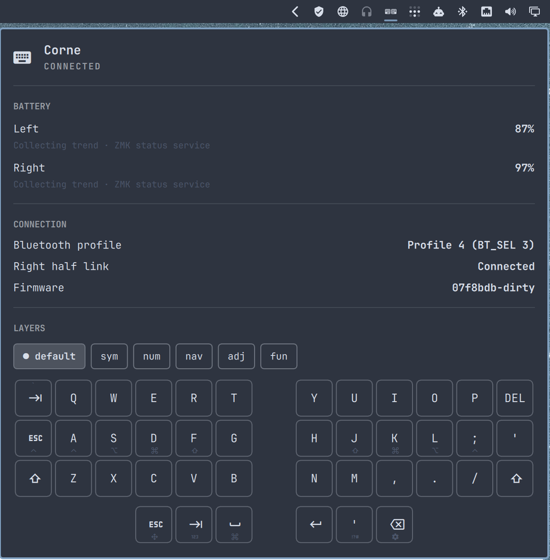

# ZMK Keyboard for Omarchy

An Omarchy shell bar widget for a [ZMK](https://zmk.dev) split keyboard
connected over Bluetooth. The bar shows a split-keyboard icon. Click it for a
panel with each half's battery and trend, the active BLE profile, the
right-half link, caps word, the firmware revision, and every layer of your
keymap drawn from a [keymap-drawer](https://github.com/caksoylar/keymap-drawer)
YAML file, following the layer you are on.



This is an unofficial project and is not affiliated with ZMK or Omarchy.

## Features

- **Bar widget.** A split-keyboard icon, dimmed while the keyboard is not
  connected. Battery and layer stay out of the bar, where they would change
  while you type; its tooltip names the keyboard.
- **Panel.**
  - Battery per half with a trend (`Draining 1.2%/h · ~3d 2h left`) and a
    small sparkline from in-memory history. The left half is seeded from
    UPower history when UPower has usable samples for the keyboard.
  - Active BLE profile, right-half connection state, caps word (when the
    firmware reports support), and firmware revision.
  - One tab per keymap layer, each rendering that layer's keys. The active
    layer's tab is marked `●` and selected, and the selection follows the
    keyboard as you switch layers. ←/→ browse the other tabs until the next
    switch.
- **Notifications** (`notify-send`). One when either half reaches 20%, 10%,
  or 5%, once per crossing per half; a threshold re-arms after the half
  climbs 3 points above it. One when the right half stays disconnected for
  more than 60 seconds while the left half is connected.

### Firmware support

Full status needs a small ZMK module on the keyboard that exposes the custom
GATT service described under [Wire contract](#wire-contract). Without it the
plugin degrades gracefully:

| Firmware | Left battery | Right battery | Layer, profile, right link, caps word, firmware |
|---|---|---|---|
| Stock ZMK | Battery Service / BlueZ | — | Unavailable |
| Stock ZMK with `CONFIG_ZMK_SPLIT_BLE_CENTRAL_BATTERY_LEVEL_PROXY` | Battery Service | Second Battery Service | Unavailable |
| With the status service | Status characteristic | Status characteristic | Available |

A reference module for ZMK v0.3.0 lives in
[`src/zmk_status_gatt.c`](https://github.com/filipechagas/zmk-config-corne/blob/1b3efd6b591db6b14af240b1a55c763a17866494/src/zmk_status_gatt.c)
of the author's Corne config, with its `CMakeLists.txt`, `Kconfig`, and
`zephyr/module.yml` wiring alongside. It builds only for the split central.
It reports no caps word state, because ZMK v0.3.0 keeps that private, so the
panel hides the caps word row.

## Requirements

- Omarchy 4 with its built-in shell (developed against `omarchy 4.0.6`,
  `quickshell 0.3.2`, Qt 6.12).
- BlueZ, with the keyboard paired and connected.
- Python 3 with:
  - `dbus-python` (`python-dbus` on Arch),
  - PyGObject (`python-gobject`) for the GLib main loop,
  - PyYAML (`python-yaml`), only when `keymapPath` is set.
- `notify-send` (`libnotify`) for notifications.
- Optional: a [Nerd Font](https://www.nerdfonts.com) (Omarchy ships several)
  so `$$mdi:…$$` legends render as icons. Without one they render as short
  text such as `Tab` or `Shft`.

The bridge runs `/usr/bin/python3` when it exists, because distro Python
packages are installed for that interpreter, and otherwise the first `python3`
on `PATH`. A version-manager shim (mise, pyenv) earlier on the shell's `PATH`
is therefore not used.

## Install

Omarchy plugins run unsandboxed inside `omarchy-shell`; review the source
first.

```bash
omarchy plugin add https://github.com/filipechagas/omarchy-zmk --enable
```

Or by hand: clone this repository to
`~/.config/omarchy/plugins/io.github.filipechagas.zmk/`, run
`omarchy-shell shell rescanPlugins`, then
`omarchy plugin enable io.github.filipechagas.zmk`.

Then set `keymapPath` (see [Settings](#settings)) to get layer names and
layouts.

## Update

```bash
omarchy plugin update io.github.filipechagas.zmk
```

Releases and their notes are listed in [CHANGELOG.md](CHANGELOG.md).

## Remove

```bash
omarchy plugin remove io.github.filipechagas.zmk
```

This disables the widget and deletes the plugin folder. The plugin writes no
files anywhere else, so nothing is left behind. The firmware module on the
keyboard keeps working without the plugin; remove it from your ZMK config if
you no longer want it.

## Settings

Settings live inline on the widget's entry in `~/.config/omarchy/shell.json`
and can also be edited from the bar settings panel. All are optional.

| Key | Type | Meaning |
|---|---|---|
| `keymapPath` | path | keymap-drawer YAML (the output of `keymap parse`). Supplies layer names and key layouts. `~` is expanded. Without it layers show as `Layer N` and no keys are drawn. |
| `deviceName` | string | Bluetooth name (Alias or Name) of the keyboard. Used to pick the keyboard when its firmware has no status service, or to choose between several. |

```json
{
  "id": "io.github.filipechagas.zmk",
  "keymapPath": "~/zmk-config/keymap-drawer/corne.yaml"
}
```

Changing a setting restarts the bridge; editing the YAML file is picked up
within about five seconds.

## How it works

`Service.qml` is a shell-level singleton. It runs `bridge/zmk_bridge.py`, a
long-running Python process that watches BlueZ on the system D-Bus and writes
one JSON object per line. Every bar instance reads that one service, so
notifications fire once however many monitors you have. The bridge exits when
its stdin closes, so it never outlives the shell.

### Finding the keyboard

The bridge rescans on BlueZ `InterfacesAdded`/`InterfacesRemoved`, on device
`Connected`/`ServicesResolved` changes, and when BlueZ restarts. It picks, in
order:

1. a connected device exposing the custom service UUID (preferring one whose
   name matches `deviceName`);
2. a connected device whose Alias or Name equals `deviceName`;
3. a connected device with BlueZ icon `input-keyboard` and a `Battery1`
   interface.

If none is connected, a paired device matching the same rules is shown as
disconnected.

### Batteries

- **Left:** status characteristic byte 8, else the main Battery Service, else
  BlueZ's `Battery1.Percentage`.
- **Right:** status characteristic byte 9, else ZMK's proxied Battery Service.
  When several Battery Level characteristics exist, the bridge reads each one's
  descriptors. The one with Characteristic Presentation Format description
  `0x0108` ("auxiliary") or User Description `Peripheral N` is the right half,
  lowest `N` first, matching `zmk/app/src/split/bluetooth/central_bas_proxy.c`.
  ZMK reports 0 for a disconnected peripheral, so a proxied 0 counts as no
  reading.

The bridge calls `StartNotify` on the status and battery characteristics. The
notify session belongs to the bridge's D-Bus connection and lasts for the
process lifetime.

### Keymap layouts

The bridge parses the YAML; QML only draws rectangles. Layer index *N* maps to
the *N*th key under `layers`. Key geometry comes from, in order:

1. `layout.qmk_info_json` pointing at a **local** QMK `info.json` (relative to
   the YAML), with `x`, `y`, `w`, `h`, and rotation;
2. `layout.ortho_layout` with integer `rows`, `columns`, `thumbs`, and `split`;
3. otherwise a guess from the key count: a split `3×C+T` or `4×C+T` grid (42 keys
   → 3×6+3 like a Corne, 36 → 3×5+3, 34 → 3×5+2), else a plain 12- or
   10-column grid.

`qmk_keyboard` and `zmk_keyboard` names are not fetched from the network, so
they use the guess. Point `qmk_info_json` at a local file for exact
geometry. Combos are ignored. The panel says so when a layer's key count
differs from the layout.

`$$mdi:name$$` legends become the codepoint the installed Nerd Font uses for
`md-name`, read from the font's own glyph-name table.

## Wire contract

GATT service `7a6f0001-2c1e-4b8a-9d33-5e4c0f1a9b20`:

**Status** `7a6f0002-2c1e-4b8a-9d33-5e4c0f1a9b20` (read, notify), 10 bytes, little-endian:

| Byte | Meaning |
|---|---|
| 0 | Protocol version, `1` |
| 1 | Highest active layer index |
| 2–5 | `uint32` active-layer bitmask |
| 6 | Active BLE profile, 0–4 |
| 7 | Flags: bit 0 right half connected, bit 1 caps word active, bit 2 caps word tracking supported |
| 8 | Left battery %, `0xFF` unknown |
| 9 | Right battery %, `0xFF` unknown |

A payload with another version byte is rejected, and the panel asks you to
update the plugin. A version-1 payload shorter than 10 bytes is rejected.
Extra trailing bytes are ignored.

**Firmware** `7a6f0003-2c1e-4b8a-9d33-5e4c0f1a9b20` (read): UTF-8 git SHA.

Also read: Battery Service `0x180F` / Battery Level `0x2A19`, with descriptors
`0x2901` (User Description) and `0x2904` (Presentation Format).

### Bridge output

Each line carries `"v": 1` and a `type`:

| `type` | When | Payload |
|---|---|---|
| `hello` | start | bridge version |
| `keymap` | start, file change | `configured`, `ok`, `layers[{index,name,keys[{t,h,s,type,glyph}]}]`, `geometry{source,width,height,keys[{x,y,w,h,r,rx,ry}]}`, `mismatchedLayers`, or `error`/`detail` |
| `state` | any visible change | `adapter`, `device{name,connected,source}`, `features`, `status`, `statusError`, `firmware`, `left`/`right{percent,source,trend}` |
| `alert` | threshold or disconnect | `kind` (`battery_low`, `right_disconnected`), `half`, `threshold`, `percent`, `device` |
| `fatal` | missing dependency | `code`, `detail` |

Commands on stdin: `{"type":"refresh"}` and `{"type":"shutdown"}`.

## Privacy

Everything stays on the machine. The bridge talks only to BlueZ and UPower
over the system D-Bus. Bluetooth addresses are not sent to the UI, and
nothing is written to disk.

## Development

```bash
tests/check.sh
```

It runs the manifest validator, the Python unit tests, `qmllint`, the QML model
tests, and a Quickshell host smoke test. The smoke test loads `Service.qml` and
`Panel.qml` against a fake bridge and a fake `notify-send`. It needs a Wayland
session, never opens the popup, and is skipped without `WAYLAND_DISPLAY`.

Run the bridge by hand to see what it reports:

```bash
python3 bridge/zmk_bridge.py --keymap path/to/keymap.yaml
python3 bridge/zmk_bridge.py --keymap path/to/keymap.yaml --keymap-only
```

## License

Copyright (c) 2026 Filipe Chagas. Licensed under the [MIT License](LICENSE).
